# Schema dei flussi — WOC backend

> Fonti: codice `develop` @ `dadf5cd`, `template.yaml`, `infrastructure/internal-api.yaml`
> e route reali dell'API Gateway **dev** (eu-west-1), verificate il 08/10/2026.

Schema completo in un'unica immagine: [schema-flussi.png](schema-flussi.png).

## Legenda

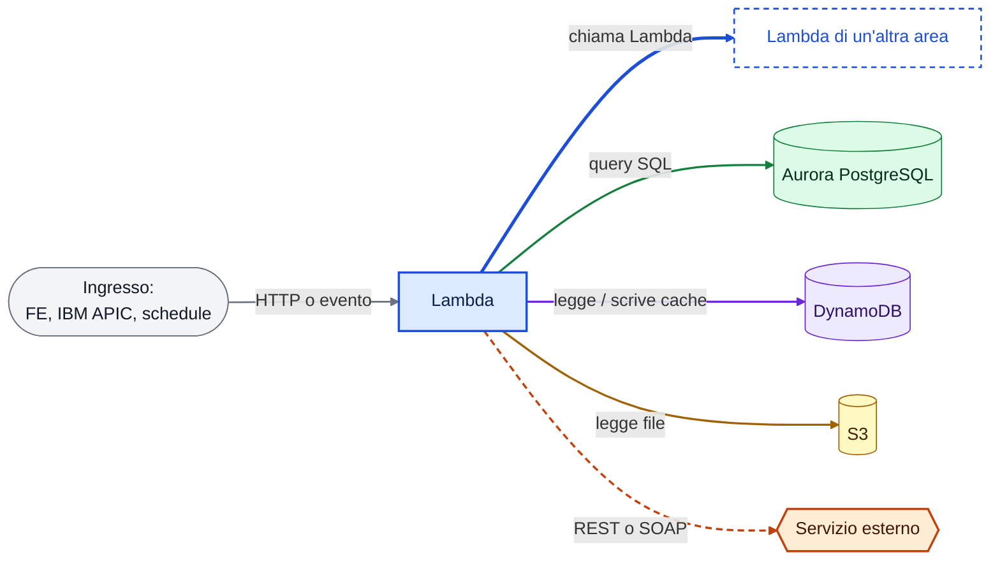

Ingressi: **Frontend WOC** = API Gateway privata, l'authorizer ricava `sub` e `roles` dal cookie;
**IBM APIC** = API B2B con authorizer a token; **EventBridge** = schedule;
**Invocazione diretta** = nessuna route API.

Nel testo gli stessi colori indicano il tipo di chiamata:

| Marcatore | Significato |
|---|---|
| 🟦 **nome** `operazione` | chiamata a un'altra Lambda: `POST /internal/<servizio>/<operazione>` sull'API privata (IAM SigV4, `serviceClient`) |
| 🟩 **DB** `tabella` | query su Aurora PostgreSQL, schema `woc`, via RDS Proxy |
| 🟪 **cache** `chiave` | DynamoDB `ddb-np-bsn0027990-<env>-tmpcache` |
| 🟨 **S3** `file` | bucket `s3-np-bsn0027990-<env>-translations` |
| 🟧 **nome** | servizio esterno (REST o SOAP, in genere esposto da IBM APIC) |
| → FE | risposta al Frontend |
| *(b-e)* | best-effort: un errore viene loggato e la risposta prosegue |
| ‖ | chiamate in parallelo |

**token PingFederate**: prima di chiamare il servizio la Lambda ottiene un token OAuth2 da 🟧 PingFederate
e lo tiene in 🟪 cache con chiave `<modulo>:authtoken` (jobcard, djc, dms, v360, srpv360ota, mopardoc;
wyz fa lo stesso con Keycloak). Per leggibilità questi passaggi non sono disegnati come frecce separate,
così come le letture di configurazione e credenziali da Secrets Manager e SSM.

## Riepilogo: chi chiama cosa

| Lambda | Invocata da | 🟦 Lambda chiamate | 🟩 Aurora | 🟪 DynamoDB | 🟨 S3 | 🟧 Servizi esterni |
|---|---|---|---|---|---|---|
| session | FE; jobcard, dms, hqmanager | mypeople, dmlconfigsync, dbmanager | — | `session:context` (solo `getData` / `getContext`) | — | — |
| translations | FE | — | — | — | `locales/` | — |
| mypeople | session | — | — | — | — | myPeople IURSMA |
| jobcard | FE; synch-status | session, dms, dbmanager, agendasoanaga | `jobcard_sync_activity` | `jobcard:jobcarddetails`, token | — | DGT / DJC, PingFederate |
| djc | invocazione diretta | agendasoanaga | `jobcard_sync_activity` | `jobcard:jobcarddetails` (lettura), token | — | DGT / DJC, PingFederate |
| synch-status | IBM APIC | jobcard | `comunication_asyncro_djc`, `jobcard_sync_activity` | — | — | — |
| agendasoa | FE | — | — | — | — | AgendaSOA |
| agendasoanaga | FE; jobcard, djc | — | — | — | — | NAGA |
| dms | FE; jobcard, dmlconfigsync, pkmanager, pkfavorite | session, v360, dbmanager | — | token | — | DML, PingFederate |
| dmlconfigsync | EventBridge; session | dms | `dml_*`, `dms_settings*` | — | — | — |
| v360 | FE; dms | — | — | `v360:getdetails`, token | `config/brandowner.json`, `config/energytype.json` | ASV360, PingFederate |
| srpv360ota | FE | — | — | token | — | SRP V360 OTA, PingFederate |
| mopardoc | FE | — | `mopardoc_inspection_media` | token | — | MoparDocs, PingFederate |
| pkmanager | FE | dbmanager, pkeper, pkmenupricing, pkdocsoa, dms | — | — | — | — |
| pkfavorite | FE | dms | `pkfavorite` | — | — | — |
| pkeper | pkmanager | — | — | — | — | ePER |
| pkmenupricing | pkmanager | — | — | — | — | MenuPricing |
| pkdocsoa | pkmanager | — | `docsoafunctions` | — | — | DocSOA |
| hqmanager | FE | session, dbmanager | — | — | — | — |
| service-hq-manager | FE | — | `customer_options`, `hq_settings_email` | — | — | — |
| isstellantisbrand | FE; invocazione diretta (`*UserSign`) | — | `anag_brand`, `dealer_sign` | — | — | — |
| dbmanager | session, jobcard, dms, pkmanager, hqmanager | — | `hq_*`, `config_packages`, `ang_snowflakes`, `addr_snowflakes`, `anag_brand` | — | `config/hq_*.json` | — |
| wyz | invocazione diretta | — | — | token (`wyz:authtoken`) | — | Wyz, Keycloak |
| auroraautostart | EventBridge (solo stage) | — | — | — | — | AWS RDS API |

---

## 1. Flussi per area

L'identità utente arriva sempre da `requestContext.authorizer.sub`.
Nei diagrammi i box tratteggiati sono Lambda descritte in un'altra area.

### 1.1 Sessione e traduzioni

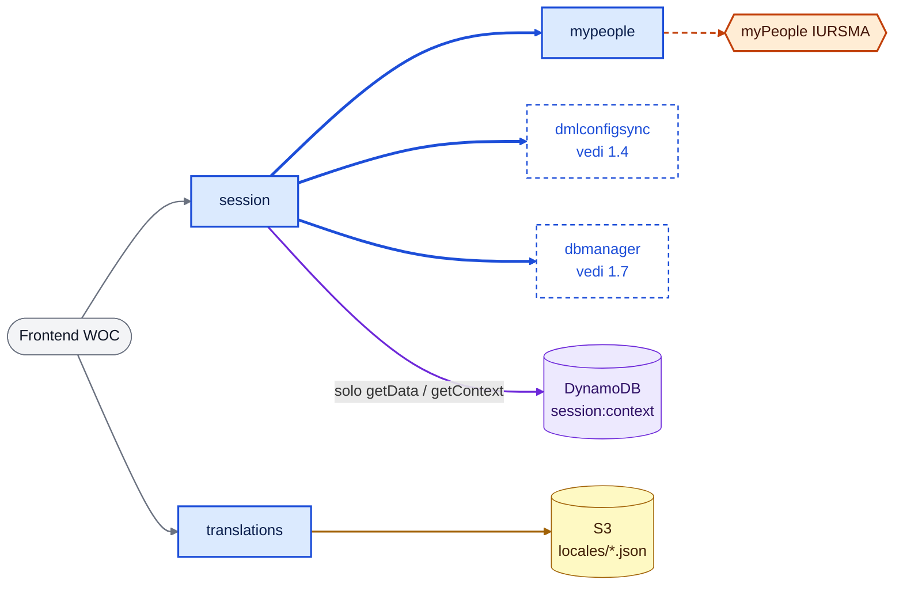

**session** — `GET /api/session`. Nessun accesso diretto ad Aurora: i dati arrivano da dmlconfigsync e dbmanager.
1. Legge `sub`, `roles` e `profile` dall'authorizer. Senza `sub` → 401.
2. Utente **HQ** (`HQCENTRAL` o `HQNSCnnnn`): sessione costruita dai ruoli, senza chiamare myPeople.
   Utente **dealer**:
   1. 🟦 **mypeople** `readUserProfiles`. RC 121 → trattato come HQ; profilo assente → 404.
   2. ‖ 10 chiamate *(b-e)*:
      - 🟦 **dmlconfigsync** `getDmsSettings` (se manca → `registerDealer`) e `getDmlConfiguration`;
      - 🟦 **dbmanager** ×8: ISO paese, sito fisico/PDV, brand, OIC disabilitati, firma, indirizzi, OIC abilitati, mercato PK.
   3. 🟦 **dbmanager** `getBrandLogos`.
3. Aggiunge `hqMarketsList`: HQ centrale → 🟦 **dbmanager** `getMarkets`; HQ mercato → dal ruolo; dealer → `[]`. → FE.

Interno `getData` / `getContext` (`getData` usato da jobcard e hqmanager, `getContext` da dms):
- 🟪 **cache** legge `session:context:<user>` (TTL 5 min);
- se manca, esegue il flusso sopra e lo scrive in 🟪 **cache**;
- `getContext` restituisce solo `mainSincom`, `market`, `language`, `dealerCountryCode`.

**mypeople** — solo interno: `readUserProfiles` → 🟧 **myPeople IURSMA** (mTLS + Basic).

**translations** — `GET /api/translations`: 🟨 **S3** `locales/<lang>/translation.json`, con fallback → FE.

### 1.2 Jobcard e DJC

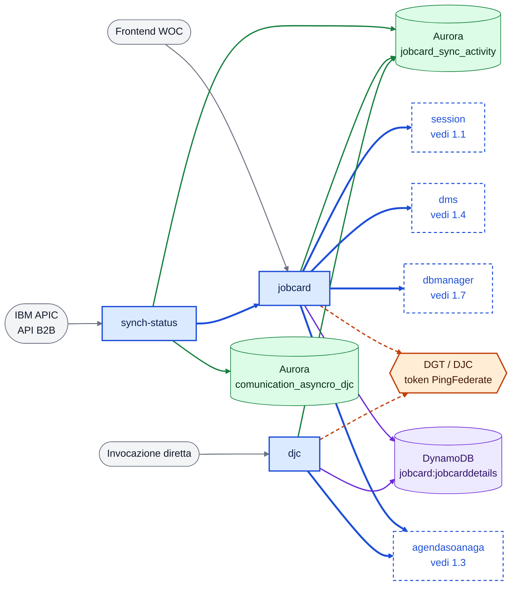

**jobcard** — `GET/POST /api/repairorder/{proxy+}` (in dev anche il POST `saveJobcard`)
- `list`, `listCurrent`: 🟧 **DGT** → FE.
- `details`:
  1. 🟧 **DGT** `jobCardDetails` (sempre live, poi sanitizzazione);
  2. 🟦 **dms** `resolveSender` → 🟦 **dms** `inquiry` *(b-e, flag `dmsAvailable`)*;
  3. 🟪 **cache** scrive `jobcard:jobcarddetails:<id>` (TTL 1 h);
  4. 🟩 **DB** legge lo stato sync da `jobcard_sync_activity` *(b-e)* → FE.
- `dml`: 🟪 **cache** legge `jobcard:jobcarddetails:<id>` (se manca, lo rigenera come `details`) → 🟦 **dms** `resolveSender` → `inquiry` → FE.
- `lastPayload`: 🟩 **DB** SELECT da `jobcard_sync_activity`, poi 🟩 **DB** DELETE della riga se `djcsynch` è false e `ack`, `techreason`, `businessreason` sono vuoti (best-effort, `deleted` nella risposta) → FE.
- `deleteSynch` (POST): 🟩 **DB** DELETE da `jobcard_sync_activity` solo se `djcsynch` è false e `ack`, `techreason`, `businessreason` sono vuoti → FE. Riga assente → 404, condizioni non rispettate → 409.
- `getDealerConfiguration`: 🟦 **dbmanager** `getVehicleInspection` → `checkIsPkMarketEnabled` → `getPackageListSM` se abilitato, altrimenti `getPackageListHQ` → FE.
- `saveJobcard`:
  1. 🟩 **DB** UPSERT del payload in `jobcard_sync_activity`. Bloccante: errore DB → 502, id mancante → 400.
  2. 🟧 **DGT** `POST /jobCard` → 🟩 **DB** UPDATE `djcsynch` true/false. Errore DGT → 502.
  3. *(b-e)* 🟦 **session** `getData` → per ogni appuntamento 🟦 **agendasoanaga** `createnaga` (solo se nuovo) e poi `updatenaga`.
  4. 🟩 **DB** legge lo stato sync → FE.
- Interno `getJobCardDetails`: come `details`, senza stato sync.

**djc** — nessuna route in dev (solo invocazione diretta).
- `SaveRoInfo`, `SaveDmsSync`, `SaveCustomer`, `SaveVehicle`, `SaveJobs`, `SaveConsents`, `SaveAppointments`: 🟪 **cache** legge `jobcard:jobcarddetails:<id>` e costruisce `json_orig` / `json_mod`. Nessuna chiamata esterna.
- `saveJobcard`: stessi passi di jobcard (🟩 UPSERT → 🟧 DGT → 🟩 `djcsynch` → 🟩 stato). Per NAGA però chiama solo 🟦 **agendasoanaga** `updatenaga`, e solo sugli appuntamenti già esistenti: niente `createnaga` e niente session.

**synch-status** — `POST /api/synch-status` e `/woc/synch-status` (API B2B, chiamata da IBM APIC)
1. Valida `eventType`, `jobCardId` e `timestamp`.
2. 🟩 **DB** UPDATE `comunication_asyncro_djc` (`djc_sync_status`, `version+1`). Se la riga non esiste → 404. La riga è inserita da un componente fuori repo.
3. *(b-e)*, eseguito anche nel caso 404:
   1. 🟩 **DB** UPDATE `jobcard_sync_activity` (`ack`, `techreason`);
   2. 🟦 **jobcard** `getJobCardDetails`;
   3. 🟩 **DB** UPDATE `businessreason`.

### 1.3 Agenda

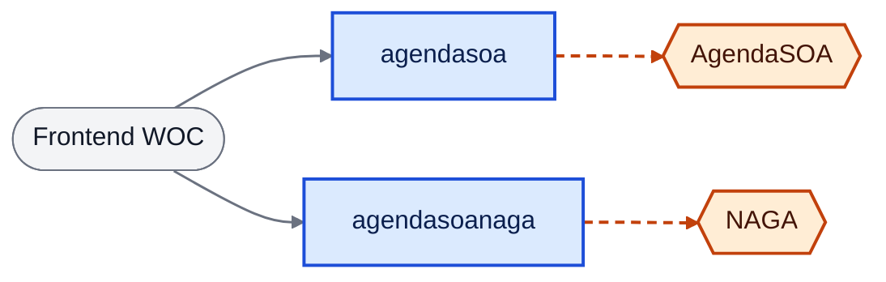

**agendasoa** — `GET /api/agendasoa/{proxy+}`: `appointment`, `availableHours`, `cCSList`, `data`, `getAvHoursForRec` → 🟧 **AgendaSOA** (mTLS + Basic) → FE.

**agendasoanaga** — `POST /api/agendasoanaga/{proxy+}`, più interno: `createnaga`, `updatenaga` → 🟧 **NAGA** (mTLS + Basic).

### 1.4 DMS / DML

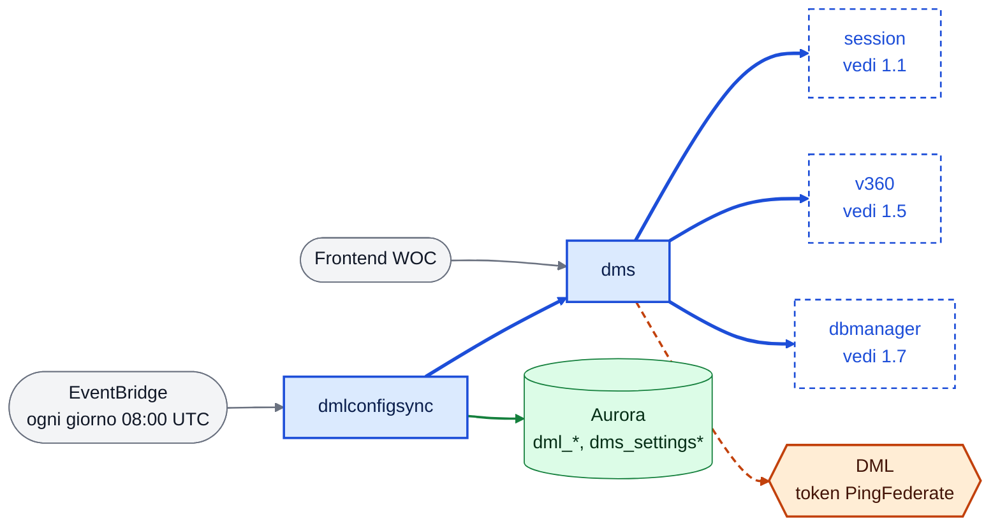

**dms** — `POST /api/repairorder/inquiry/{LFP|WL|MP}`, `GET /api/settings/dml/current`
- `inquiry`:
  1. Mittente, in sequenza e *(b-e)*: 🟦 **session** `getContext` → 🟦 **v360** `getBrand(vin)`.
  2. ApplicationArea: 🟦 **dbmanager** `getPhysicalSiteAndSincom` → 🟦 **v360** `getBrandOwners`.
  3. 🟧 **DML** → FE.
- `settings`: 🟧 **DML** → FE.
- Interno: `resolveSender` (solo il passo 1), `inquiry`, `settings`, `company-types`, `customer-titles`.

**dmlconfigsync** — schedule giornaliero, più interno
- Batch:
  1. 🟩 **DB** ‖ legge `dml_enabled_markets` e `dms_settings_enabled_dealers`.
  2. Per mercato: 🟦 **dms** ‖ `company-types` + `customer-titles` → 🟩 **DB** UPSERT `dml_configurations`.
  3. Per dealer: 🟦 **dms** `settings` → 🟩 **DB** UPSERT `dms_settings`.
- Interno: `getDmlConfiguration` e `getDmsSettings` (🟩 **DB** SELECT), `registerDealer` (🟩 **DB** INSERT in `dms_settings_enabled_dealers`).

### 1.5 Veicolo e documenti

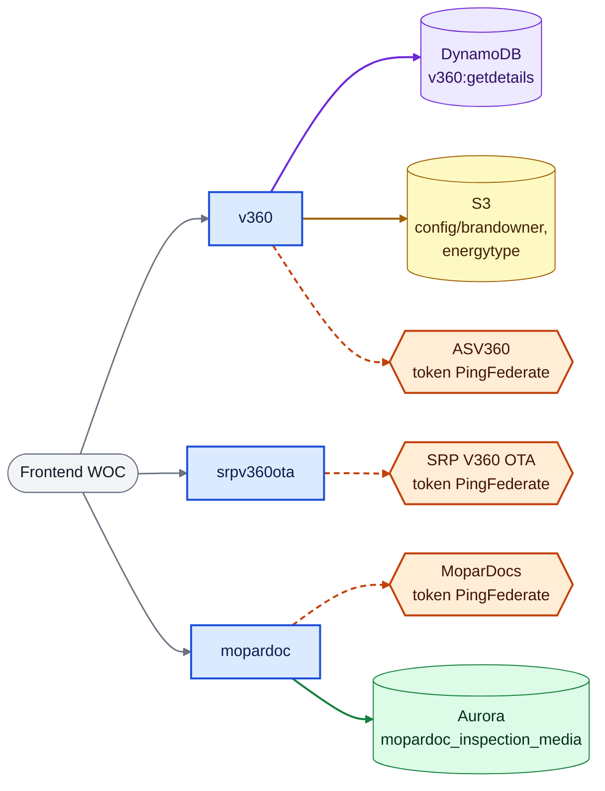

**v360** — `POST /api/repairorder/v360/{proxy+}`
- `getdetails`: 🟪 **cache** `v360:getdetails:<vin>` (TTL 1 h). Se manca: 🟧 **ASV360** + 🟨 **S3** `config/brandowner.json` e `config/energytype.json` → FE.
- `otaCompatibility`: 🟧 **ASV360** → FE.
- Interno: `getBrand` (via getdetails), `getBrandOwners` (🟨 **S3**).

**srpv360ota** — `POST /api/v360/otaCompatibility`: configurazione da SSM e Secrets Manager → 🟧 **SRP V360 OTA** → FE.

**mopardoc** — `POST /api/repairorder/mopardoc/{proxy+}`. Tutte le 13 azioni chiamano 🟧 **MoparDocs / job-docs**.
- `getJobCardAndDocumentList`, `getDocuments`: arricchiti con 🟩 **DB** `mopardoc_inspection_media`.
- `createJobCardAndUploadDocument`: `createJobCard` → `getUploadDocURL` → PUT del file sull'URL firmato MoparDocs → `uploadedDoc` → 🟩 **DB** salva i metadati.
- `deleteDocumentsByVin`: elenco documenti → `DeleteDocuments` → 🟩 **DB** DELETE dei metadati *(b-e)*.

### 1.6 Pacchetti

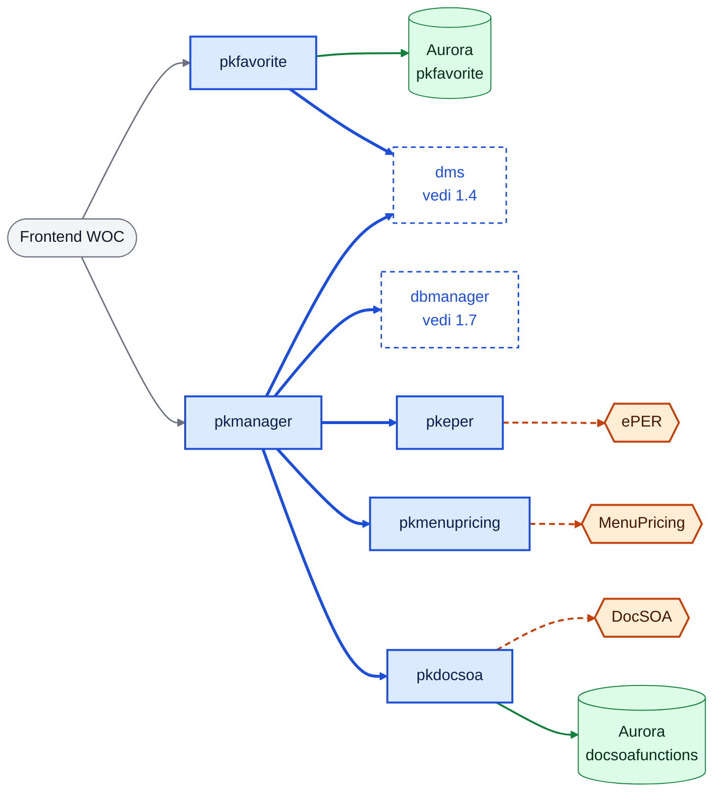

**pkmanager** — `GET /api/pkmanager/{proxy+}`. Nessun accesso diretto a DB o servizi esterni: passa sempre da altre Lambda.
- `getConfigPackages`: 🟦 **dbmanager** (🟩 `config_packages`).
- `getValidPackages`: config ∩ lista live. La lista live dipende da `pkwstouse`: 🟦 **pkeper** `getCompletePkEperList`, 🟦 **pkmenupricing** `getCompletePkMpList` oppure 🟦 **pkdocsoa** `getCompletePkSOAList`.
- `getValidPackagesDetail`: `getValidPackages` → dettaglio per pacchetto (concorrenza limitata): `getPackageDetailsPR`, `getJobDetails` oppure `ibxDetailForfaitService` con fallback `ibxDetailtpService`.
- `getPriceAndAvailability`: `getValidPackagesDetail` → 🟦 **dms** `resolveSender` → `inquiry`.
- `getPkList`: 🟦 **dbmanager** `getPkwstouse` (🟩 `hq_pkconfig`) → `getValidPackagesDetail` → `getPriceAndAvailability` (errore DML → `dmlWarning`) → merge per `WorkLineReference` → FE.

**pkfavorite** — `GET/POST /api/favorite`
- GET: 🟩 **DB** SELECT `pkfavorite` → 🟦 **dms** `resolveSender` → ‖ N × 🟦 **dms** `inquiry` → FE.
- POST: 🟩 **DB** INSERT oppure DELETE (toggle).

**pkeper** — solo interno: SOAP → 🟧 **ePER**. `getCompletePkEperList` = gruppi → sottogruppi → pacchetti, con concorrenza limitata.

**pkdocsoa** — solo interno:
- `getCompletePkSOAList`: 🟩 **DB** legge `docsoafunctions` → 🟧 **DocSOA** ‖ forfait + quick estimate.
- Dettagli `ibxDetailForfaitService` / `ibxDetailtpService`: solo 🟧 **DocSOA**.

**pkmenupricing** — solo interno: SOAP WS-Security → 🟧 **MenuPricing** (`getJobs`, `getJobDetails`).

### 1.7 HQ e configurazione

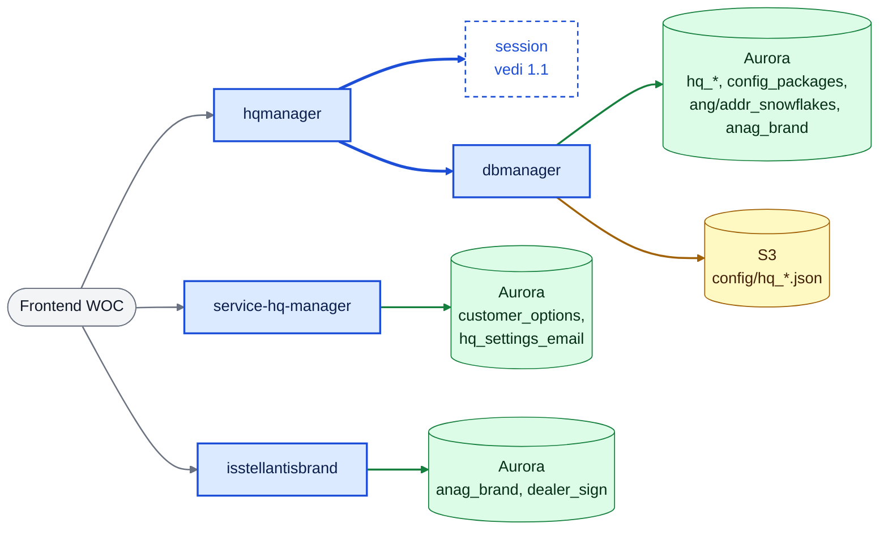

**hqmanager** — `GET/POST /api/hq/{proxy+}` (28 azioni). Nessun accesso diretto al DB: passa sempre da dbmanager.
- Ogni azione → 🟦 **dbmanager**.
- `setEnablingConfiguration`, `insertAudit` e le scritture sulle ispezioni veicolo: 🟦 **session** `getData` (nome e mercato utente) → audit in 🟩 `hq_audit` via dbmanager.
- `importAppConfiguration` / `exportAppConfiguration` / `exportAudit`: file XLSX in Base64, elaborato nella Lambda.
- `getAnagSection` / `getAnagAllocation`: 🟦 **dbmanager** → 🟨 **S3** `config/hq_sections.json` e `config/hq_actiontype.json`.

**service-hq-manager** — `/api/customer-options[/{proxy+}]`, `/api/hq-settings-email[/{proxy+}]`: CRUD 🟩 **DB** su `customer_options` e `hq_settings_email`.

**isstellantisbrand** — `GET /api/isStellantisBrand`: 🟩 **DB** SELECT `anag_brand` → FE. Le azioni `*UserSign` (🟩 **DB** `dealer_sign`) sono solo a invocazione diretta.

**dbmanager** — solo interno: 🟩 **DB** query su tabelle HQ e anagrafiche per session, jobcard, dms, pkmanager e hqmanager. Legge anche 🟨 **S3** `config/hq_*.json`.

### 1.8 Altro

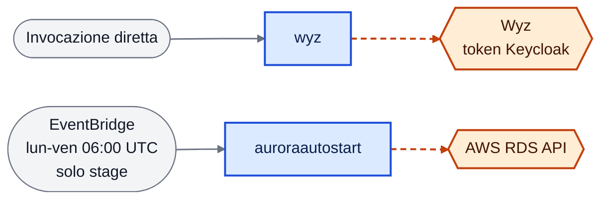

**wyz** — nessuna route (solo invocazione diretta): token OAuth2 da 🟧 **Keycloak Wyz** (🟪 **cache** `wyz:authtoken`) → `getSearchFilters` (‖ 4 GET) e `searchQuote` → 🟧 **Wyz**.

**auroraautostart** — solo stage, lun-ven alle 06:00 UTC: 🟧 **AWS RDS API** `DescribeDBClusters` → `StartDBCluster`.

---

## 2. Chiamate interne: operazioni

| Chiamante | 🟦 Lambda chiamata | Operazioni |
|---|---|---|
| session | mypeople | `readUserProfiles` |
| session | dmlconfigsync | `getDmsSettings`, `registerDealer`, `getDmlConfiguration` |
| session | dbmanager | `getCountryIsoCode`, `getPhysicalSiteAndPdvId`, `getBrandsByOics`, `getDisabledOics`, `getEnableSignatureByOics`, `getAddressByOics`, `getOicEnabled`, `checkIsPkMarketEnabled`, `getBrandLogos`, `getMarkets` |
| jobcard | dms | `resolveSender`, `inquiry` |
| jobcard | session | `getData` |
| jobcard | agendasoanaga | `createnaga`, `updatenaga` |
| jobcard | dbmanager | `getVehicleInspection`, `checkIsPkMarketEnabled`, `getPackageListSM`, `getPackageListHQ` |
| djc | agendasoanaga | `updatenaga` |
| synch-status | jobcard | `getJobCardDetails` |
| dms | session | `getContext` |
| dms | v360 | `getBrand`, `getBrandOwners` |
| dms | dbmanager | `getPhysicalSiteAndSincom` |
| dmlconfigsync | dms | `settings`, `company-types`, `customer-titles` |
| pkmanager | dbmanager | `getPkwstouse`, `getConfigPackages` |
| pkmanager | pkeper | `getCompletePkEperList`, `getPackageDetailsPR` |
| pkmanager | pkmenupricing | `getCompletePkMpList`, `getJobDetails` |
| pkmanager | pkdocsoa | `getCompletePkSOAList`, `ibxDetailForfaitService`, `ibxDetailtpService` |
| pkmanager | dms | `resolveSender`, `inquiry` |
| pkfavorite | dms | `resolveSender`, `inquiry` |
| hqmanager | session | `getData` (nome e mercato utente per l'audit) |
| hqmanager | dbmanager | 28 operazioni: configurazione, ispezioni, domini, pacchetti, audit |

Ricevitori interni: `session`, `mypeople`, `dms`, `dmlconfigsync`, `dbmanager`, `v360`, `jobcard`,
`agendasoanaga`, `pkeper`, `pkdocsoa`, `pkmenupricing`.

---

## 3. Flussi end-to-end principali

Ogni chiamata verso Aurora, DynamoDB o un servizio esterno è un messaggio esplicito.
I riquadri colorati raggruppano Lambda, dati e servizi esterni.

### 3.1 Login dealer (`GET /api/session`)

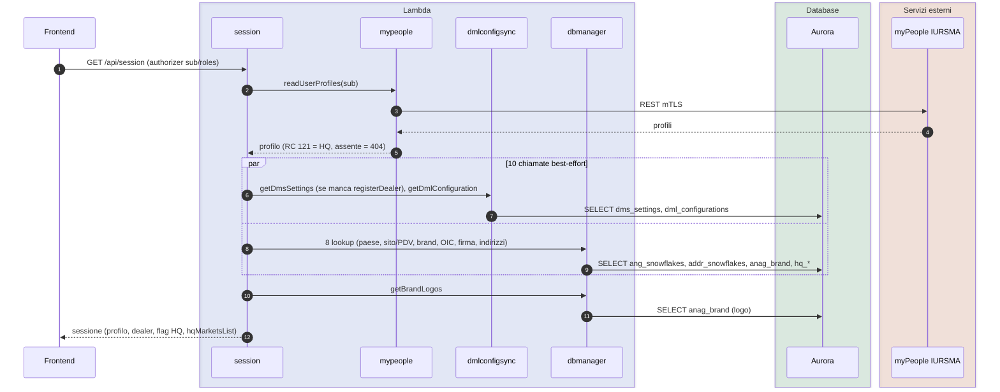

### 3.2 Jobcard: dettaglio e salvataggio

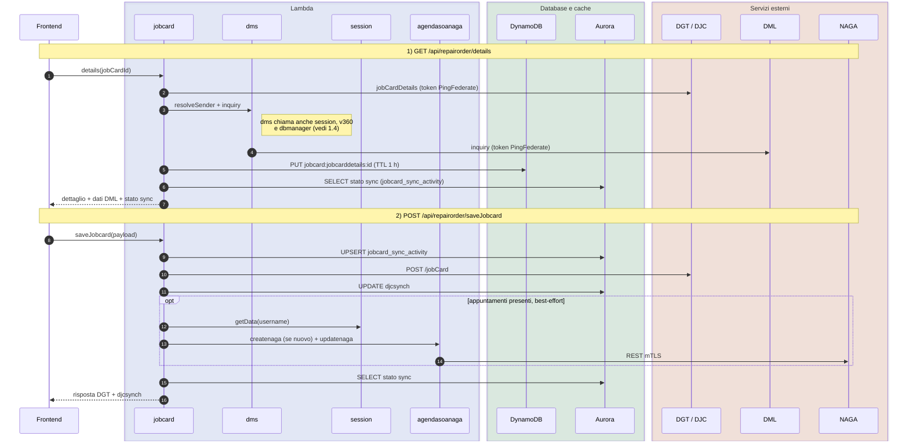

### 3.3 Esito asincrono DJC (`POST /api/synch-status`)

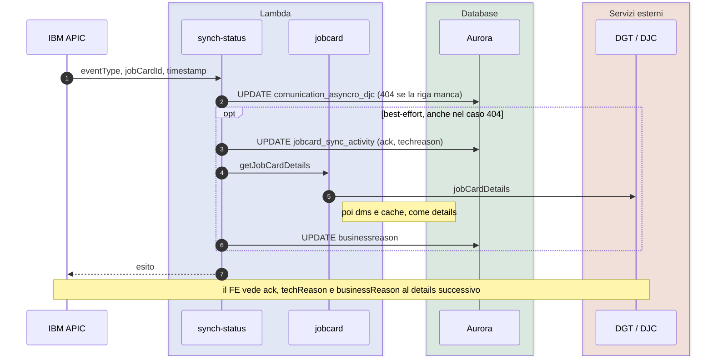

### 3.4 Lista pacchetti (`GET /api/pkmanager/getPkList`)

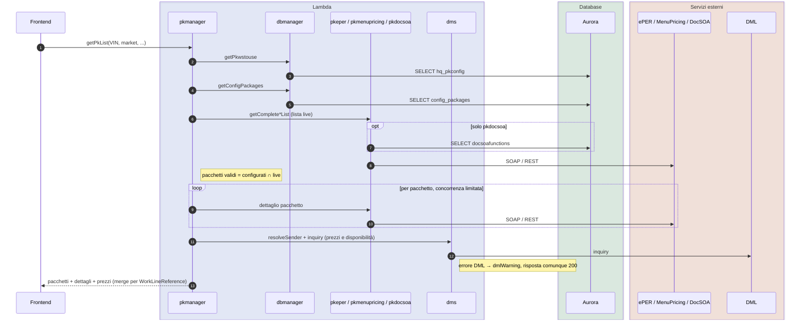

---

## 4. Dati

**🟩 Aurora PostgreSQL (schema `woc`)**

| Tabella | Scrive | Legge |
|---|---|---|
| `jobcard_sync_activity` | jobcard, djc (payload, `djcsynch`); synch-status (`ack`, `techreason`, `businessreason`); jobcard DELETE (`deleteSynch`, `lastPayload`) | jobcard, djc |
| `comunication_asyncro_djc` | synch-status (UPDATE); INSERT fuori repo | — |
| `dml_enabled_markets`, `dms_settings_enabled_dealers` | dmlconfigsync (`registerDealer`) | dmlconfigsync |
| `dml_configurations`, `dms_settings` | dmlconfigsync (batch) | dmlconfigsync → session |
| `hq_*`, `config_packages`, `ang_snowflakes`, `addr_snowflakes`, `anag_brand` | dbmanager (per hqmanager) | dbmanager (per session, jobcard, dms, pkmanager, hqmanager); isstellantisbrand (`anag_brand`) |
| `pkfavorite` | pkfavorite | pkfavorite |
| `dealer_sign` | isstellantisbrand | isstellantisbrand |
| `customer_options`, `hq_settings_email` | service-hq-manager | service-hq-manager |
| `mopardoc_inspection_media` | mopardoc | mopardoc |
| `docsoafunctions` | — | pkdocsoa |

**🟪 DynamoDB `tmpcache`**
- Dati: `jobcard:jobcarddetails:<id>` (TTL 1 h; scrive jobcard, legge djc), `session:context:<user>` (TTL 5 min), `v360:getdetails:<vin>` (TTL 1 h).
- Token: `<modulo>:authtoken` per jobcard, djc, dms, v360, srpv360ota, mopardoc, wyz.

**🟨 S3 `translations`**
- `locales/<lang>/translation.json` (translations).
- `config/brandowner.json`, `config/energytype.json` (v360).
- `config/hq_sections.json`, `config/hq_actiontype.json` (dbmanager).

---

## 5. Note e discrepanze rilevate

- In dev **`POST /api/repairorder/saveJobcard` arriva a `jobcard`**, non a `djc`: djc non ha route. Il README dice il contrario.
- Senza route FE in dev: `djc`, `wyz`, `pkeper`, `pkdocsoa`, `pkmenupricing`. Le loro azioni sono raggiungibili solo via `/internal` o con invocazione diretta.
- La policy IAM consente `jobcard → dbmanager/getOicEnabled`, ma il codice non la usa.
- Il percorso CLI di jobcard (`node index.js saveJobcard`) sincronizza NAGA **prima** del salvataggio DGT; la Lambda lo fa **dopo**.
- Stage e prod: va ancora eseguito `sql/alter_table_jobcard_sync_activity_add_djcsynch.sql` prima di rilasciare jobcard e djc.
- Tutti gli ambienti: prima di rilasciare jobcard con `deleteSynch` e la DELETE di `lastPayload` va eseguito `sql/grant_delete_jobcard_sync_activity.sql` (GRANT DELETE a `wiadvisor_app`; su dev già applicato).
- Componenti fuori repo nello stesso account: `auth`, `authorizer`, `b2b-authorizer`, `presign` (`/api/files`), `health`, `apic-consumer` (SQS).
